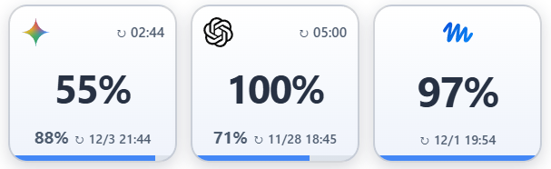

# Agent Usage HUD

Antigravity・Codex・Meta Muse の残りクレジット／クォータを Stream Deck 風のコンパクトな最前面ウィンドウで常時表示する Windows 向け Electron アプリです。



## 特徴
- **常に最前面表示 (Always on Top)**・枠なし透過・どこでもドラッグ移動可能・位置自動記憶
- **Stream Deck 風の横並びタイル UI**
  - 上段：サービスアイコン ＋ 5時間枠リセット時刻 (`↻ HH:mm`)
  - 中段：5時間枠の残量（Muse は週間残量）
  - 下段：週間残量 ＋ 週間リセット日時 (`↻ M/D HH:mm`)
  - 下端バー：週間残量ゲージ（30%未満で赤色表示）
- **ライト / ダークテーマ**、サイズ（S / M / L）、不透明度、更新間隔をカスタマイズ可能
- **タスクトレイ常駐**・右クリックメニューですぐ更新／設定／終了

## 起動方法

初回のみ依存パッケージをインストールします：

```powershell
npm install
```

起動は以下のどちらでも行えます：
- `start.bat` をダブルクリック
- ターミナルから `npm start`

## 各サービスの連携方法

### 1. Codex
ローカルの `%USERPROFILE%\.codex\auth.json` を自動読み込みし、5時間枠と週間枠の残量・リセット時刻を取得します。

### 2. Antigravity
以下のいずれかで残量・リセット時刻を取得します：
- **公式 `statusLine` ブリッジ（推奨・CLI 併用時）**: `~/.gemini/antigravity-cli/settings.json` に `scripts/agy-statusline-bridge.js` を設定するとキャッシュ JSON から即時読み込みます。
- **Antigravity CLI (`agy`)**: キャッシュが無い場合は `agy -p /usage --output-format json` から自動取得します。

### 3. Meta Muse (`muse.ai`)
設定画面の **「Muse にログイン (muse.ai)」** からサインインすると、アプリ内の永続セッションを使って `muse.ai` から週間残量・リセット日時を直接取得します。
（Muse Code CLI の `~/.config/muse/auth.json` が存在する場合はそちらも自動検出します）
